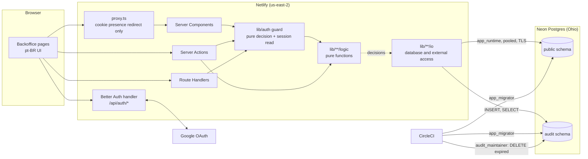
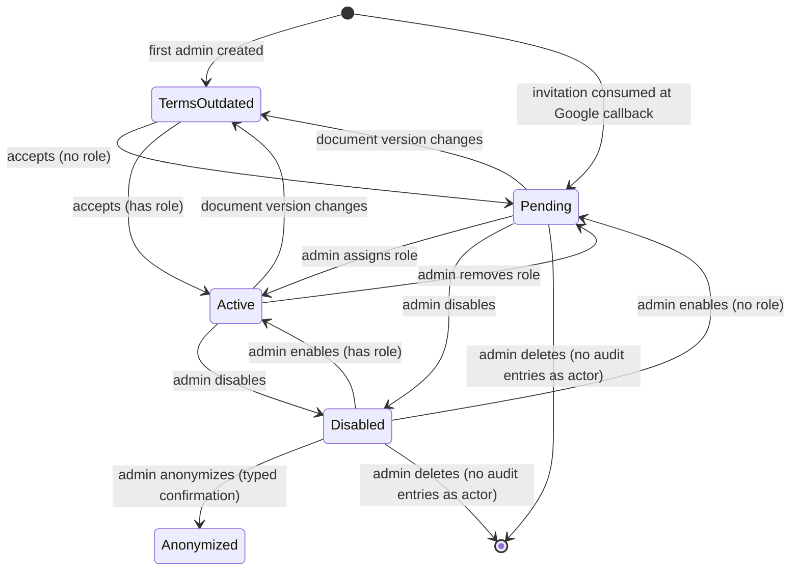

# Database Foundation and Backoffice Access

*   **Author:** Bruno Nardini
*   **Status:** Approved
*   **Date:** 2026-11-15

--------------------------------------------------------------------------------

## Overview

Nardini Select is a dog-focused pet shop in Resende, RJ, Brazil. Its public, open-source repository holds only the institutional home page today (Next.js 16 App Router, React 19, TypeScript 6, Base UI, Netlify, CircleCI, Sentry, semantic-release). The site will grow into an online store with real customers and sales.

This design adds three parts that later store features build on:

*   **Part A, data and delivery:** a Postgres database (Neon in production, a separate Neon project for previews, Docker locally and in CI), versioned migrations, seeds, database credentials scoped per role, and a pipeline that migrates before it deploys.
*   **Part B, identity and access:** a backoffice that invited users sign in to with Google. Each user has zero or one role; a user with a role is approved. One central server-side check guards every private page and operation. State-changing operations are written to an audit log that the application can only insert into and read.
*   **Part C, privacy:** an inventory of the personal data the backoffice holds, versioned terms of use and privacy notice, irreversible anonymization, retention rules, and scrubbing of personal data from Sentry.

Business rules live in the application, as pure functions with full unit-test coverage. The database stores data and enforces structure (keys, uniqueness, foreign keys) and access (grants per role); it holds no business logic (no triggers, no stored procedures).

The three parts ship through the milestones in [Milestones](#milestones). Real data is stored in production only after the production-data gate in that section is met.

## Problem Statement

The shop cannot manage a catalog, stock, or orders through the website: there is no database and no way to know who is acting. Building catalog or order features first would put real customer data into a system with no access control, no record of who changed what, and no defined legal basis under LGPD (Lei Geral de Proteção de Dados, Brazil's data protection law).

Four constraints shape the solution:

1.  **The repository is public.** Anyone can read the code, the CI configuration, and the migrations. Security rests on credentials that never enter the repository and on checks that hold even when their workings are known.
2.  **Cost and lock-in.** No paid auth service, no Redis, free and open-source libraries only, and no Neon-specific feature without the owner's explicit approval. Native Postgres features are allowed.
3.  **Small team, real data.** Day-to-day users are a few people, employees or not. Controls must be operable without an on-call rotation or extra paid services.
4.  **LGPD.** The backoffice stores personal data (names, emails, Google account IDs, photos, activity). Each item needs a purpose, a legal basis, and a retention rule, and data subjects must be able to have their data erased.

## Goals

### Part A: Data and delivery

*   **G-A1** Production runs on the Neon project `nardini-select` (AWS US East 2, Ohio). The hosted preview runs on the separate Neon project `nardini-select-stg`, which holds only fake data. No credential works across environments.
*   **G-A2** Local development and all automated tests (unit, E2E) run on a Postgres container: Docker Compose locally, a service container in CircleCI. Automated tests never reach Neon, the preview URL, or the production URL.
*   **G-A3** Every schema change is a versioned, forward-only SQL migration that runs inside a transaction (except statements Postgres forbids in transactions, which get their own file). A migration must work with the code of the previous release (expand/contract).
*   **G-A4** Each environment has three application database roles plus the Neon owner: `app_migrator` (schema changes, CI only), `app_runtime` (data reads and writes, no DDL, insert and select only on the audit log), and `audit_maintainer` (deletes expired audit entries and invitations). Connections to Neon require TLS with `sslmode=verify-full`.
*   **G-A5** On every push to `main`: the production migration runs, then semantic-release, then the production deploy if a version was cut. A failed migration stops the pipeline. Branch protection on `main`, applied to admins too, requires the PR checks and an up-to-date branch.
*   **G-A6** The preview uses the same build-and-deploy process as production, with two differences: it starts only after a manual approval in CircleCI, and it uses the preview context (Neon `nardini-select-stg`, fixed `staging` alias).
*   **G-A7** Seeds populate the development, test, and preview databases with fixed data plus generated data from `@faker-js/faker` with a fixed seed. Fake data never reaches production.
*   **G-A8** All primary keys are UUIDs. Table and column names are English, plural snake_case for tables, snake_case for columns. All timestamps are `timestamptz` stored in UTC; the API exchanges ISO 8601 strings with `Z`; the browser converts to local time for display.

### Part B: Identity and access

*   **G-B1** Users sign in with Google only. Login methods live in their own table so more methods can be linked to one user later without a schema change.
*   **G-B2** Sessions live in Postgres. Logout deletes **all** of the user's sessions. Disabling, deleting, or anonymizing a user deletes all of their sessions in the same transaction. Every later request from any tab or browser is refused; open tabs redirect to sign-in on their next focus or request.
*   **G-B3** Every private page, Server Action, and Route Handler calls one central function that checks the session, the viewer's state, and admin rights before doing anything. The browser receives this information only to show or hide UI.
*   **G-B4** New users join only through an invite link created by an admin. The link is single use and expires after 30 minutes. The admin sets the user's full name. Accepting the terms of use is required before the "Entrar com Google" button works.
*   **G-B5** One fixed system role, `admin`, has full access. Admins create other roles (name only in this release). A user with no role sees only the "cadastro em aprovação" screen; a user with any role is approved.
*   **G-B6** The system always keeps at least one active admin. No admin can disable, delete, anonymize, or change the role of their own user.
*   **G-B7** The first admin in production is created only when the `users` table is empty and the verified Google email equals `BOOTSTRAP_ADMIN_EMAIL`. Nothing is printed in CI logs.
*   **G-B8** The state-changing operations listed in [B7](#b7-audit-log) are recorded in an audit log that only the system writes, no one edits, and only admins read and search. Entries older than 6 months are deleted twice a week.

### Part C: Privacy

*   **G-C1** A data inventory lists every personal data field with its purpose, legal basis, retention, storage region, and processor.
*   **G-C2** Users accept the terms of use and acknowledge the privacy notice before their account exists (invite page) or before anything else (first admin, new versions). The system stores the version and time of each.
*   **G-C3** An admin can anonymize a disabled user. Anonymization is irreversible, needs the admin to type the user's full name, and clears every personal field and linked login while the audit log stays intact.
*   **G-C4** User data is served only by authenticated backoffice routes. Photos go through an authenticated proxy. Sentry events carry only the user UUID, after scrubbing.

## Non-Goals

*   Customer accounts, catalog, stock, orders, and payments.
*   Granting permissions to roles. The `role_permissions` table and the permission check exist, but the permission editor and the first permission keys arrive with the first business feature.
*   Login methods other than Google (Apple, passkeys, username and password), linking a second login method, and a "last used method" hint.
*   More than one role per user.
*   Phone number and Gravatar.
*   Deleting audit log entries from the backoffice.
*   Access logging beyond the audit log; planned separately before the store launch.
*   Tamper evidence for the audit log (hash chains, external signing).
*   Production tests that need a database credential.
*   Writing the final legal text of the terms and notice, and signing processor agreements (tracked outside this document).

## Open Questions

*   **Better Auth fit** (checked in milestone M0, a throwaway investigation branch before implementation; see [Milestones](#milestones)): the exit criteria in [M0 exit criteria](#m0-exit-criteria).
*   **Legal and contractual prerequisites** (processor agreements, legal review of the terms and notice) are tracked in the internal risk register. They block the production-data gate.

## Critical User Journeys (CUJs)

### CUJ 1: The owner becomes the first admin

*   **Covers:** G-B7, G-C2.
*   **Given**: Production has been migrated and the `users` table is empty. `BOOTSTRAP_ADMIN_EMAIL` is set in Netlify's production context.
*   **When**: The owner opens `/admin/entrar` and signs in with the Google account whose verified email matches `BOOTSTRAP_ADMIN_EMAIL`.
*   **Then**: In one transaction that locks `users` against concurrent inserts, the system confirms the table is still empty, creates the user with the `admin` role and the Google name, email, and photo, and writes `user.registered` and `bootstrap.claimed` with the system actor. The owner lands on `/admin/termos/aceitar`, accepts the terms, acknowledges the notice, and continues to `/admin/perfil`. From then on, `users` is never empty, so no other sign-in can create an admin this way.

### CUJ 2: An admin invites a new user, who joins

*   **Covers:** G-B4, G-B5, G-C2.
*   **Given**: An active admin is signed in.
*   **When**: The admin clicks "Convidar usuário", types the person's full name, and copies the link shown with "Esse link expira em 30 minutos". The person opens the link within 30 minutes, checks "Li e aceito os termos de uso" (with links to the terms and the privacy notice), and clicks "Entrar com Google", which stays disabled until the box is checked.
*   **Then**: At the Google callback, the invitation is consumed and cannot be used again. The user row is created with the admin-typed `full_name`, `invited_at` copied from the invitation, the Google name as `display_name`, the Google photo (or none), the Google email, `registered_at`, and the accepted document versions. The user lands on `/admin/perfil`, where they may change the display name and photo. On `/admin` they see "Cadastro em aprovação" and a "Sair" button. Audit entries: `invitation.created` (admin), `user.registered` (system).

### CUJ 3: An admin approves a user by assigning a role

*   **Covers:** G-B5.
*   **Given**: A user with no role exists.
*   **When**: The admin creates the role "Estoquista" (name only) and assigns it to the user.
*   **Then**: On the user's next request, `/admin` shows "Olá, <display_name>." The user's sessions are not touched, because the guard reads the role on every request. Audit entries: `role.created`, `user.role_changed`.

### CUJ 4: A non-admin user is refused an admin operation

*   **Covers:** G-B3.
*   **Given**: An approved user without the `admin` role.
*   **When**: The user opens `/admin/usuarios`, then sends a crafted request to the disable action.
*   **Then**: The page shows "Você não tem permissão para acessar esta página." The action returns a typed "forbidden" result with no database change. Both refusals are reported to Sentry as warnings, not to the audit log. The menu never showed the link.

### CUJ 5: An admin cuts a user's access, then erases them

*   **Covers:** G-B2, G-C3.
*   **Given**: A user with audit entries as actor; the acting admin is someone else.
*   **When**: The admin disables the user. Later, the admin chooses "Anonimizar", reads the irreversibility warning, types the user's full name, and confirms.
*   **Then**: Disabling deletes every session at once; the user cannot sign in. Anonymizing clears full name, display name, email, photo, linked Google account, and sessions, sets `anonymized_at`, and keeps the UUID. Audit entries stay untouched and show the actor as "Usuário removido". The user can never be re-enabled. "Excluir" is not offered, because the user has audit entries as actor.

### CUJ 6: A user logs out while signed in on two browsers

*   **Covers:** G-B2.
*   **Given**: A user is signed in on a laptop and a phone, with two tabs open on the laptop.
*   **When**: The user clicks "Sair" on the laptop.
*   **Then**: All of the user's sessions are deleted. The other laptop tab and the phone redirect to `/admin/entrar` on their next focus or request. No data request succeeds on any of them until the user signs in again.

### CUJ 7: The owner tests a PR on the preview

*   **Covers:** G-A1, G-A6.
*   **Given**: A PR from a branch in this repository, with every validation job green.
*   **When**: The owner approves the `preview-approval` hold in CircleCI.
*   **Then**: The `nardini-select-stg` database is recreated (migrations plus seed), and the PR is built and deployed to the fixed `staging` alias with the preview context, the same way production is deployed. Google sign-in works there with the preview OAuth client. Preview runs are serialized: a second approval waits, then replaces the first. No production credential is involved.

### CUJ 8: A merge with a migration reaches production

*   **Covers:** G-A3, G-A5.
*   **Given**: A PR that adds a migration is merged into an up-to-date `main`.
*   **When**: The `main` pipeline runs.
*   **Then**: The production migration runs inside a transaction under an advisory lock, then semantic-release runs, then the production deploy runs if a version was cut. If the migration fails, it rolls back, nothing else runs, the previous release keeps running on the unchanged schema, and the fix ships in a new PR. A merge with no release still applies its migrations.

### CUJ 9: Expired data is deleted

*   **Covers:** G-B8, G-C1.
*   **Given**: It is Monday or Friday, 06:00 UTC (03:00 in Brasília).
*   **When**: The scheduled `retention` job runs with the `audit_maintainer` credential.
*   **Then**: It deletes audit entries older than 6 months and invitations older than 7 days, whatever their status. Entries therefore live at most 6 months and 4 days. The job writes nothing else.

## Technical Plan (Architecture)

### Architecture diagram

### Milestones

Each milestone is one PR (M4 may ship as one PR per page) and leaves `main` releasable. Every file in the [Detailed Implementation Plan](#detailed-implementation-plan) names its milestone.

| Milestone | Content | Depends on |
| --- | --- | --- |
| M0 | Investigation branch, never merged: Better Auth fit, Netlify runtime variables for the preview context, Neon Postgres major version | — |
| M1 | Database tooling, roles, first migrations, Docker, CI database steps, production migrate → release → deploy order | — (does not wait for M0) |
| M2 | Preview: `nardini-select-stg`, preview jobs, preview OAuth client | M1 |
| M3 | Auth core: Better Auth, guard, first admin, invitations, audit writer, terms acceptance, Sentry scrubbing, sign-in and invite pages, terms acceptance page | M0, M1 |
| M4 | Backoffice pages: home, profile, users, invitations, roles, audit viewer | M3 |
| M5 | Privacy completion: anonymization, retention job, data inventory, final notice pages | M4 |

M0 results can change Parts B and C only; Part A (M1, M2) proceeds without them.

**Production-data gate.** No real customer or user data (other than the owner's own account) is stored in production until all of these hold: M5 is live; the legal and contractual prerequisites in the internal risk register are met.

### M0 exit criteria

1.  Better Auth's `user.create.before` hook can read a request cookie and the user and account inserts run in one database transaction that our code joins, so invitation consumption and user creation commit or roll back together. If not, the fallback is Arctic with our own sessions.
2.  Better Auth can use our table and column names, Postgres-generated `uuid` IDs, and our Kysely instance.
3.  OAuth access and refresh tokens can be left unstored; IP address and user agent can be left unstored in sessions.
4.  Every unused endpoint, including Better Auth's own sign-out, can be disabled; the session cookie can be host-only with `Secure`, `HttpOnly`, `SameSite=Lax`.
5.  Our code can list and delete a user's sessions.
6.  A Netlify Function deployed to the `staging` alias with `--context deploy-preview` reads the deploy-preview variables at runtime.
7.  Neon's Postgres major version is known (it sets the Docker image tag).

### Code organization and testing rule

All business rules are pure functions in `lib/<area>/logic/` (no I/O, no clock, no randomness; inputs are passed in). They have 100% unit-test coverage. Code that touches anything outside the process (Postgres, Better Auth, Google, Sentry, cookies, the clock) lives in `lib/<area>/io/` as thin adapters: they read inputs, call a pure function, and write its result. Adapters, pages, Server Actions, and Route Handlers are excluded from unit coverage by an explicit path list and are exercised by E2E tests against the Docker database. React client components keep the existing rule (unit tests and stories).

### Part A: Data and delivery

#### A1. Environments

| Environment | Database | Where it runs | Data | Google OAuth client |
| --- | --- | --- | --- | --- |
| Production | Neon project `nardini-select`, database `nardini_prod` | Netlify production context | Real (after the production-data gate) | Production client, redirect `https://<production domain>/api/auth/callback/google` |
| Preview | Neon project `nardini-select-stg`, database `nardini_stg` | Netlify alias `staging`, deploy-preview context | Fake (seed) | Preview client, redirect `https://staging--<site>.netlify.app/api/auth/callback/google` |
| Development | Docker, database `nardini_dev` | `npm run dev` | Fake (seed) | Development client, redirect `http://localhost:3000/api/auth/callback/google` |
| Test | Docker locally, service container in CircleCI, database `nardini_test` | Playwright E2E | Fake (seed, fixed faker seed) | None: tests never call Google |

Netlify's automatic Git builds are turned off for every branch. CircleCI deploys production and the preview.

#### A2. Database roles and grants

Each environment has the same three application roles plus the Neon owner. Passwords differ per environment and never enter the repository.

| Role | Used by | Grants |
| --- | --- | --- |
| Neon owner | The owner, in the Neon console only | Everything; runs the provisioning file once |
| `app_migrator` | Migration jobs, local `db:migrate` | Owns every table in `public` and `audit`; runs DDL |
| `app_runtime` | The Next.js server | `SELECT`, `INSERT`, `UPDATE`, `DELETE` on tables in `public`; `INSERT`, `SELECT` on `audit.events`; `USAGE` on both schemas; no `CREATE` |
| `audit_maintainer` | The scheduled `retention` job | `SELECT`, `DELETE` on `audit.events` and `public.invitations`; nothing else |

*   `REVOKE CREATE ON SCHEMA public FROM PUBLIC` and `REVOKE ALL ON DATABASE <name> FROM PUBLIC`.
*   `ALTER DEFAULT PRIVILEGES FOR ROLE app_migrator IN SCHEMA public GRANT SELECT, INSERT, UPDATE, DELETE ON TABLES TO app_runtime`.
*   Grants on `audit.events` and the `audit_maintainer` grants are explicit in the migrations that create those tables.
*   Each role has `timezone = 'UTC'` set with `ALTER ROLE`.
*   `db/provision/roles.sql` creates the roles and schema grants. A Node script, `db/provision/apply.ts`, runs it with passwords from environment variables; Docker init, CI, and the owner (once per Neon project) use it.
*   The `db-check` CI job compares the actual grants in the Postgres catalogs with this table and fails on any difference. This verifies configuration, not business rules.

#### A3. Connections

*   `pg` (node-postgres) with Kysely. The Neon serverless driver is not used (lock-in).
*   Runtime: `DATABASE_URL` points at Neon's pooled endpoint (transaction pooling) as `app_runtime`, with `sslmode=verify-full`. The pool is sized for transaction pooling (a few connections per function instance). Only transaction-scoped locks are used in request code.
*   Migrations and retention: `DATABASE_MIGRATION_URL` and `AUDIT_MAINTAINER_URL` use the direct endpoint. They exist only in CircleCI contexts and in the local `.env`.
*   Timestamps cross the data layer as UTC ISO 8601 strings; the browser formats them with `Intl.DateTimeFormat`.
*   In the production context only, the database module checks `current_database()` against `nardini_prod` on its first connection and refuses every query on a mismatch, reporting to Sentry.
*   The database and auth modules are created lazily on first use and throw if called during `next build`. Every backoffice route reads cookies, so it is dynamic. The build needs no database or auth variables.

#### A4. Schema

All tables use `uuid` primary keys with `DEFAULT gen_random_uuid()`. Names are plural snake_case; timestamps end in `_at`.

**`public` schema:**

| Table | Purpose | Columns |
| --- | --- | --- |
| `users` | One row per backoffice user (Better Auth's user model plus our fields) | `id`, `full_name`, `display_name`, `email` (unique), `email_verified`, `photo_url`, `photo_source` (`provider` or `none`), `role_id` (nullable FK to `roles`, `ON DELETE RESTRICT`), `invited_at`, `registered_at`, `last_login_at`, `disabled_at`, `anonymized_at`, `terms_version`, `terms_accepted_at`, `privacy_notice_version`, `privacy_notice_acknowledged_at`, `created_at`, `updated_at` |
| `user_accounts` | Login methods linked to a user | `id`, `user_id` (FK, cascade), `provider_id`, `provider_account_id` (Google `sub`), unique (`provider_id`, `provider_account_id`), `created_at`, `updated_at`. No OAuth tokens. |
| `sessions` | Active sessions | `id`, `user_id` (FK, cascade), `token` (unique), `expires_at`, `created_at`, `updated_at`. No IP address or user agent. |
| `verifications` | Short-lived OAuth state (Better Auth) | `id`, `identifier`, `value`, `expires_at`, `created_at`, `updated_at` |
| `roles` | Roles | `id`, `name` (unique, case-insensitive), `is_system`, `created_at`, `updated_at`. The `admin` row has a fixed UUID defined in code and inserted by a migration. |
| `role_permissions` | Permissions granted to a role (no editor in this release) | `role_id` (FK, cascade), `permission_key` (text), primary key (`role_id`, `permission_key`) |
| `invitations` | Pending, used, and canceled invites | `id`, `full_name`, `token_hash` (bytea, unique), `expires_at`, `created_by` (uuid, no FK), `created_at`, `canceled_at`, `used_at`, `used_by_user_id` (uuid, no FK) |

**`audit` schema:**

| Table | Columns |
| --- | --- |
| `audit.events` | `id`, `occurred_at`, `actor_type` (`user` or `system`), `actor_id` (uuid, no FK), `action`, `entity_type`, `entity_id` (uuid, nullable, no FK), `metadata` (jsonb), `metadata_version` (smallint), `trace_id`. Indexes on (`occurred_at`, `id`), `actor_id`, (`entity_type`, `entity_id`), `action`. |

The system actor has a fixed UUID defined in code; it never exists in `users`.

The database enforces structure only: keys, `NOT NULL`, uniqueness, and foreign keys (`ON DELETE RESTRICT` on `role_id` keeps a role with users from being deleted). Every business rule (at least one admin, no self-targeting, no re-enabling an anonymized user, the system role is read-only, invitation validity) lives in pure functions in `lib/**/logic/`. Adapters that change admins or invitations take row locks (`SELECT ... FOR UPDATE`) inside the transaction before calling the pure function, so concurrent requests are decided one at a time.

#### A5. Migrations

*   node-pg-migrate with plain `.sql` files in `db/migrations/` (`<timestamp>_<description>.sql`). Each file runs in a transaction under an advisory lock; files that cannot run in a transaction declare it in their header and contain only that statement.
*   Forward only. Mistakes are fixed by a new migration.
*   Expand/contract: migration N works with the code of release N-1. Renames and drops take two releases. Each migration sets `lock_timeout` and `statement_timeout`.
*   squawk lints new migration files in CI.
*   `kysely-codegen` writes `db/schema.d.ts`; CI regenerates it from an empty migrated database and fails on a difference.

#### A6. Seeds

*   `db/seeds/fixed.ts`: data tests rely on, with UUIDs exported from `db/seeds/ids.ts`: one admin; for each Playwright worker slot, one user per state (no role, approved, disabled, anonymized); two roles; one valid, one expired, and one canceled invitation.
*   `db/seeds/fake.ts`: extra users and audit events over the last eight months with `@faker-js/faker` (`pt_BR`, fixed seed).
*   The seed refuses to run unless `current_database()` is `nardini_dev`, `nardini_test`, or `nardini_stg`. Because the seed always creates users, the first-admin path is closed in every seeded environment.

#### A7. CI/CD

**PR workflow (`validate`)**, in addition to today's jobs:

*   `db-check` (Postgres service container): provisions roles, applies all migrations to an empty database, runs squawk, diffs `db/schema.d.ts`, and checks the grant table in A2.
*   `e2e-tests`: Postgres service container; provisions, migrates, and seeds `nardini_test` before Playwright starts.
*   Preview, for branches in this repository only, after every validation job passes:
    1.  `preview-approval` (manual hold).
    2.  `preview-migrate` (context `nardini-select-preview-db`): drops and recreates the `public` and `audit` schemas in `nardini_stg` as `app_migrator`, provisions schema grants, migrates, and seeds.
    3.  `preview-deploy` (context `nardini-select-preview-deploy`): builds and deploys with the pinned `netlify-cli`, `--context deploy-preview --alias staging`, the same command shape as production.
    The three jobs share the serial group `preview`. The hold and the preview jobs are not required status checks.

**`main` workflow**, all three jobs in the serial group `production`:

1.  `migrate-production` (context `nardini-select-prod-migrate`): runs node-pg-migrate against production on every push; a no-op when nothing is pending. Stores its output as an artifact.
2.  `release` (context `nardini-select-release`, after lint, typecheck, unit tests, and `migrate-production`): semantic-release; writes the new version, if any, to the workspace file `release/version`.
3.  `deploy-production` (context `nardini-select-prod-deploy`): halts when `release/version` is absent; otherwise builds with `SENTRY_RELEASE` and deploys with `--prod`, as today.

**Scheduled workflow `retention`** (cron `0 6 * * 1,5`, Monday and Friday 06:00 UTC): one job per environment (production, preview), contexts `nardini-select-prod-retention` and `nardini-select-preview-retention`.

Context restrictions are set in CircleCI's own settings: production contexts only for `main`; preview contexts only for non-fork pipelines. Branch protection on `main` includes admins.

**Preview credentials.** The preview deploy job uses the same deploy process and credential type as production. Controls: manual approval before every run; only branches in this repository (forks receive no secrets); the preview database credential reaches only `nardini-select-stg`.

#### A8. Local development

*   `docker-compose.yml` runs Postgres on Neon's major version, bound to `127.0.0.1:5432`, with a named volume. Its init step runs `db/provision/apply.ts` to create `nardini_dev`, `nardini_test`, and the roles.
*   npm scripts: `db:up`, `db:migrate`, `db:seed`, `db:reset`, `db:codegen`, `db:lint`, `db:provision`.
*   `.env.example` lists every variable with local example values.

### Part B: Identity and access

#### B1. Better Auth configuration

*   Google is the only provider. Email and password sign-in are off. Automatic account linking by email is off.
*   `user.create.before` admits a new user only through one of two paths, decided by the pure function `decideSignUp` in `lib/auth/logic/sign-up.ts`:
    *   **Invitation:** the invite cookie carries a valid token (not used, not canceled, not expired) and the accepted document versions equal the current ones. The invitation is consumed with `UPDATE invitations SET used_at = now(), used_by_user_id = $id WHERE id = $id AND used_at IS NULL AND canceled_at IS NULL AND expires_at > now()`; zero updated rows refuses the sign-up.
    *   **First admin:** no invite cookie, `users` has zero rows (checked after `LOCK TABLE users IN SHARE ROW EXCLUSIVE MODE` in the same transaction), the Google email is verified, and it equals `BOOTSTRAP_ADMIN_EMAIL` (case-insensitive).
    Profiles with `email_verified = false` are refused.
*   On creation the user gets `display_name` from the Google name, `photo_url` from the Google picture when present (`photo_source = provider`, otherwise `none`), and the email.
*   `session.create.before` refuses disabled or anonymized users and sets `last_login_at` and `photo_url`.
*   Sessions: 12-hour idle expiry, refreshed at most hourly; the guard also refuses sessions older than 7 days. The cookie cache is off, so every request reads the session row.
*   Cookies: `Secure`, `HttpOnly`, `SameSite=Lax`, host-only, signed with `BETTER_AUTH_SECRET`. Session storage follows Better Auth's built-in model. Key rotation: rotate `BETTER_AUTH_SECRET` and delete all rows in `sessions` (`docs/deployment.md`).
*   Rate limiting: Better Auth's limiter with in-memory storage. On short-lived functions it limits little; it is defense in depth, and nothing depends on it.
*   Endpoint surface: only social sign-in, the OAuth callback, and get-session stay enabled. Logout is our own Server Action (B6).
*   The invite cookie (`HttpOnly`, `Secure`, `SameSite=Lax`, 30 minutes) holds the invitation token and the accepted versions. It is set by the invite page's Route Handler when the user submits the terms checkbox and starts the Google redirect.
*   Only `lib/auth/io/` imports `better-auth`.

#### B2. The central check

`lib/auth/logic/access.ts` holds the decision as a pure function; `lib/auth/io/guard.ts` reads the session and user and applies it.

*   **Viewer states:** `terms_outdated` (stored versions differ from the current ones, or none), `pending` (no role), `active` (has a role). Disabled and anonymized users have no valid session.
*   **One options object** for all entry points: `{ allow: ViewerState[], adminOnly?: boolean }`.
*   **Decision** (`decideAccess(viewer, options)`): no viewer → `sign_in`; state not in `allow` → redirect target for that state (`terms_outdated` → `/admin/termos/aceitar`, `pending` → `/admin`, `active` → `/admin`); `adminOnly` and not admin → `forbidden`; otherwise `allow`.
*   `requirePage(options)` for pages, `withAction(options, inputSchema, handler)` for Server Actions (Sentry instrumentation, zod input validation, one transaction, audit writer bound to it), `withRoute(options, handler)` for Route Handlers (401 or 403 JSON; for non-`GET`, `Sec-Fetch-Site: same-origin` or an `Origin` equal to the site URL).
*   `AuthorizedContext` is a branded type only the guard creates; every function in `lib/**/io/` that reads or writes business data takes it first.
*   `lib/auth/logic/public-routes.ts` lists the public paths: `/admin/entrar`, `/admin/convite/[token]` and its `iniciar` route, `/admin/termos`, `/admin/privacidade`, `/api/auth/*`. `proxy.ts` redirects any other `/admin/*` request without a session cookie to `/admin/entrar`; it reads no database and is not a security boundary.
*   ESLint: `lib/db/` importable only from `lib/**/io/` and `db/`; `better-auth` only from `lib/auth/io/`; `lib/auth/io/test-session.ts` only from `e2e/`.
*   A unit test reads the route table below and every `page.tsx`, `actions.ts`, and `route.ts` under `app/admin/`, and fails when one is missing from the table or not built with the guard.

| Entry point | `allow` | `adminOnly` |
| --- | --- | --- |
| `/admin` (home) | `pending`, `active` | no |
| `/admin/perfil` and its actions | `pending`, `active` | no |
| `/admin/termos/aceitar` and its action | `terms_outdated` | no |
| Logout action | all states | no |
| `/admin/usuarios`, `/admin/usuarios/[id]`, their actions | `active` | yes |
| Invitation dialog actions | `active` | yes |
| `/admin/papeis`, `/admin/papeis/[id]`, their actions | `active` | yes |
| `/admin/auditoria` | `active` | yes |
| `/admin/api/avatar/[userId]` | `pending`, `active` | no |

The admin user always has a role (`admin`), so admins are `active` once their terms are current.

#### B3. Roles and permissions

*   Roles page: list (with user counts), create, rename, delete with confirmation (only roles with no users). The `admin` role cannot be renamed or deleted (`lib/roles/logic/rules.ts`).
*   Assigning any role approves the user. Changing a role does not touch sessions: the guard reads the role on every request, and nothing about roles is cached in the session or cookie. This is a stated invariant in AGENTS.md and the guard tests.
*   `lib/permissions/logic/check.ts` (`can(viewer, key, catalog)`) and an empty `lib/permissions/catalog.ts` exist for the first business feature, unit-tested with a test catalog. No permission editor in this release.

#### B4. User lifecycle

Rules, all in `lib/users/logic/rules.ts`:

*   Only admins change other users. No admin targets their own user for disable, delete, anonymize, or role change.
*   An operation that would leave no active admin with a role is refused with "O sistema precisa de pelo menos um admin ativo." The adapter locks all admin rows (`SELECT ... FOR UPDATE`) before deciding.
*   An anonymized user cannot be enabled.
*   Delete is allowed only when `audit.events` has no row with `actor_id` equal to the user. `user.registered` is written by the system actor, so a user who never acted can be deleted.
*   Disable, delete, and anonymize delete all of the target's sessions in the same transaction.
*   Anonymize sets `full_name` and `display_name` to null, `email` to `anonymized+<id>@invalid`, `photo_url` to null, deletes `user_accounts` and `sessions` rows, clears `full_name` on the user's invitation if it still exists, and sets `anonymized_at`. The UI shows "Usuário removido".

#### B5. Profile and photos

*   On first access after sign-up, the user lands on `/admin/perfil`: display name and photo choice (Google photo or none). Full name and email are read-only there; admins edit full name on the user page.
*   Photos are served by `GET /admin/api/avatar/[userId]`. It fetches only `https://lh3.googleusercontent.com/`, follows no redirects, times out after 5 seconds, accepts only `image/*` up to 1 MB, and returns `Cache-Control: private, max-age=3600`. `photo_url` comes only from the verified ID token. Without a photo, the page shows initials.

#### B6. Logout

*   "Sair" calls the `signOut` Server Action (`app/admin/actions.ts`), which deletes all of the viewer's sessions and clears the cookie. Better Auth's own sign-out endpoint is disabled.
*   A client component calls get-session when the tab gains focus and redirects to `/admin/entrar` when the session is gone.

#### B7. Audit log

*   `lib/audit/logic/actions.ts` defines each action: entity type, metadata schema (zod), version, and pt-BR template. Metadata holds only IDs, enums, field names, and named business labels (role names); free text typed about people is not accepted. Code review of this file enforces the rule.
*   `lib/audit/io/record.ts` inserts in the caller's transaction, so an audit row exists only if the change commits.
*   Not audited: sign-in, sign-out, refusals (Sentry warnings), page views.

| Action | Actor | Entity | Metadata | pt-BR text |
| --- | --- | --- | --- | --- |
| `bootstrap.claimed` | system | user | — | "o primeiro admin foi criado" |
| `user.registered` | system | user | `invitation_id` (nullable) | "{usuário} entrou no sistema" |
| `user.terms_accepted` | user | user | `terms_version`, `privacy_notice_version` | "aceitou os termos de uso versão {v}" |
| `user.profile_updated` | user | user | `fields` (enum list) | "atualizou o perfil" |
| `user.full_name_updated` | admin | user | — | "alterou o nome completo de {usuário}" |
| `user.role_changed` | admin | user | `from_role_id`, `to_role_id`, role names | "mudou o papel de {usuário} de '{a}' para '{b}'" |
| `user.disabled` / `user.enabled` | admin | user | — | "desabilitou {usuário}" / "habilitou {usuário}" |
| `user.deleted` | admin | user | — | "excluiu um usuário" |
| `user.anonymized` | admin | user | — | "anonimizou um usuário" |
| `invitation.created` / `invitation.canceled` | admin | invitation | — | "criou um convite" / "cancelou um convite" |
| `role.created` / `role.renamed` / `role.deleted` | admin | role | role name (and previous name) | "criou o papel '{nome}'" / … |

Names in the text are joined from `users` at display time; anonymized users show as "Usuário removido". The viewer at `/admin/auditoria` filters by actor, action, entity type, entity ID, and date range, with keyset pagination on (`occurred_at`, `id`).

#### B8. Sign-in errors

`/admin/entrar?erro=<code>` shows a fixed pt-BR text for each enum code; any other value shows the generic text. Codes: `convite_invalido`, `convite_expirado`, `termos_obrigatorios`, `email_nao_verificado`, `acesso_negado` (no invitation and not the first admin), `usuario_desabilitado`, `erro` (generic).

### Part C: Privacy

#### C1. Data inventory

Legal bases refer to LGPD art. 7: II, compliance with a legal obligation; V, performance of a contract to which the data subject is party (the terms of use); VI, exercise of rights in legal proceedings; IX, legitimate interest.

| Data | Purpose | Legal basis | Retention | Stored in | Processors |
| --- | --- | --- | --- | --- | --- |
| Full name, display name, email | Identify the user and show who acted | V | Until anonymized | Neon (US) | Neon, Netlify |
| Google account ID | Sign-in | V | Until anonymized | Neon (US) | Neon, Google |
| Photo URL | Show the user's picture | V | Until changed or anonymized | Neon (US) | Neon, Google |
| Session (token, dates) | Keep the user signed in | V | 12 h idle, 7 days max, deleted on logout | Neon (US) | Neon |
| Invited, registered, last sign-in, disabled, anonymized dates | Manage access | V | Until anonymized | Neon (US) | Neon |
| Terms and notice versions and dates | Prove acceptance and acknowledgment | V and II | Until anonymized | Neon (US) | Neon |
| Invitation (full name typed by an admin) | Let the invited person join | V (preliminary steps) and IX | 7 days | Neon (US) | Neon |
| Audit events (actor UUID, action, entity, metadata) | Security, fraud prevention, accountability | IX and VI | 6 months (plus up to 4 days) | Neon (US) | Neon |
| Error reports (user UUID only, scrubbed) | Fix errors | IX | Sentry plan retention | Sentry (US) | Sentry |

#### C2. Terms of use and privacy notice

*   `lib/legal/versions.ts` holds the current versions. The texts are public pages at `/admin/termos` and `/admin/privacidade`.
*   Invite page: "Li e aceito os termos de uso" checkbox, links to both documents, and "Entrar com Google" disabled until checked; the server also refuses the start route without the checkbox.
*   `/admin/termos/aceitar`: shown to the first admin and to anyone whose stored versions differ from the current ones; records `user.terms_accepted`.
*   The notice discloses the international transfer to the US (Neon, Netlify, Google, Sentry) and the retention periods above.

#### C3. Sentry

*   `sendDefaultPii: false` in the three `Sentry.init` calls.
*   `beforeSend` and `beforeSendTransaction` (pure functions in `lib/sentry/logic/scrub.ts`) remove the `code` and `state` query parameters, invitation tokens, cookies, and `authorization` headers.
*   `Sentry.setUser({ id })` with the internal UUID only.

### Risk register

Accepted risks, legal status, and external prerequisites are tracked in an internal register outside the public repository. The production-data gate depends on it.

## Alternatives Considered

### Login and identity

#### Alternative A: Username and password

*   **Pros**: No dependency on a Google account; works for anyone with an email.
*   **Cons**: Needs an email service for verification and password reset (cost or quota, DNS setup, another international transfer); stores password hashes, so a database leak exposes credentials; needs brute-force and leaked-password protection without Redis; needs TOTP to match the two-step verification Google already offers.
*   **Reason for Rejection**: Rejected by author: more code and more attack surface than delegating credentials to Google.

#### Alternative B: Sign in with Apple

*   **Pros**: Common on iPhones; offers private relay emails.
*   **Cons**: Requires the paid Apple Developer Program (US$ 99 per year); returns no photo; returns the name only on the first authorization.
*   **Reason for Rejection**: Rejected by author: recurring cost.

#### Alternative C: Passkeys in this release

*   **Pros**: Phishing-resistant, no third party, free; could serve as a second factor for admins.
*   **Cons**: Brings second-method linking, admin approval of linked methods, and the last-used hint into scope.
*   **Reason for Rejection**: Deferred by author to the next release. The `user_accounts` table already supports more than one method per user.

#### Alternative D: Paid or hosted auth services (Auth0, Clerk, and similar)

*   **Pros**: Less code to own; managed MFA and admin consoles.
*   **Cons**: Recurring cost; users live outside our database; migrating away means a forced re-login or a password export.
*   **Reason for Rejection**: Rejected by author: cost and lock-in.

#### Alternative E: Auth.js

*   **Pros**: Widely used with Next.js; database sessions supported.
*   **Cons**: v5 spent a long time in beta, and maintenance has moved under the Better Auth team.
*   **Reason for Rejection**: Its maintenance moved to the Better Auth team (announced in 2025); adopting Better Auth directly avoids depending on a project in transition.

#### Alternative F: Arctic plus sessions we write ourselves

*   **Pros**: Smallest dependency; exact fit for the invite and bootstrap flows; no unused endpoints.
*   **Cons**: We own every security check (state, PKCE, nonce, ID token validation, session rotation) in a public repository.
*   **Reason for Rejection**: Rejected by author as first choice: every line of session code we write is attack surface. Kept as the fallback if the Better Auth spike fails.

#### Alternative G: Stateless JWT sessions

*   **Pros**: No database read per request.
*   **Cons**: A token stays valid until it expires; logout, disabling, and role changes cannot take effect at once without a deny list, which needs a fast store such as Redis.
*   **Reason for Rejection**: Rejected by author: immediate revocation is a requirement and Redis is ruled out by cost.

### Data and delivery

#### Alternative H: Drizzle ORM with drizzle-kit

*   **Pros**: Types come from the TypeScript schema with no generation step from the database.
*   **Cons**: Migrations are generated from schema diffs; renames and expand/contract steps sometimes come out as drop-and-create and must be fixed by hand; grants, triggers, and partitions live outside the declared schema anyway.
*   **Reason for Rejection**: Rejected by author: hand-written SQL migrations are easier to review in a public PR and to lint.

#### Alternative I: Kysely's own migrator (TypeScript migrations)

*   **Pros**: One dependency fewer.
*   **Cons**: Migrations are executable code that SQL linters cannot read, and an old migration can change behavior after a Kysely upgrade.
*   **Reason for Rejection**: Rejected by author for the same review and lint reasons.

#### Alternative J: Prisma

*   **Pros**: Popular, with generated types.
*   **Cons**: Its query engine and connection handling add risk in serverless functions behind a transaction pooler.
*   **Reason for Rejection**: Kysely on `pg` covers the same need with fewer moving parts behind a transaction pooler.

#### Alternative K: Down migrations

*   **Pros**: A scripted way back.
*   **Cons**: Rarely tested, and a down step that drops a column destroys data written since the up step.
*   **Reason for Rejection**: Expand/contract keeps the previous release compatible with the new schema, so a code rollback of one release needs no schema rollback; data mistakes are fixed forward.

#### Alternative L: Previews on the production database

*   **Pros**: Previews behave exactly like production.
*   **Cons**: Unreviewed PR code runs with production credentials against real customer data.
*   **Reason for Rejection**: Rejected by author: unacceptable risk to real data.

#### Alternative M: Neon branches for staging

*   **Pros**: Fast copies; one project to manage.
*   **Cons**: A branch from production copies its data and roles; branching is a Neon-only workflow.
*   **Reason for Rejection**: Rejected by author: a separate project (`nardini-select-stg`) shares nothing with production and keeps the workflow portable.

#### Alternative N: One preview per PR (per-PR aliases and databases, or an OAuth relay)

*   **Pros**: Several PRs can be tested at the same time.
*   **Cons**: Google accepts only exact redirect URIs, so each alias needs a relay with a strict allowlist; each PR needs its own database and cleanup.
*   **Reason for Rejection**: Rejected by author: previews are rare, so one fixed `staging` alias recreated on each deploy is enough.

#### Alternative O: Netlify's automatic preview builds

*   **Pros**: No CircleCI job; the preview link is posted on the PR.
*   **Cons**: Netlify builds before any migration runs, so previews would run against a schema that does not match the code.
*   **Reason for Rejection**: Rejected by author: migration must come before deploy.

#### Alternative P: Re-running E2E on `main` before production

*   **Pros**: Catches problems introduced by merging.
*   **Cons**: Slower releases; duplicates work already done on the PR.
*   **Reason for Rejection**: Rejected by author: branch protection with up-to-date branches makes `main` identical to the validated PR tree.

#### Alternative Q: Production smoke test with a database credential

*   **Pros**: Verifies the deployed site can reach the database.
*   **Cons**: Puts another production secret in CI and writes test data into production.
*   **Reason for Rejection**: Adds a production secret to CI for little gain. A later read-only check without credentials remains possible.

#### Alternative R: Neon serverless driver

*   **Pros**: Lower connection latency from serverless functions.
*   **Cons**: Neon-only API.
*   **Reason for Rejection**: Lock-in to Neon, which the constraints forbid without the owner's approval. `pg` over the pooled endpoint is used.

### Access model

#### Alternative S: Fixed roles in code

*   **Pros**: Each new role is a reviewed PR; no role editor to build.
*   **Cons**: The owner needs a developer for every role change.
*   **Reason for Rejection**: Rejected by author: admins must create and edit roles themselves.

#### Alternative T: Several roles per user

*   **Pros**: Combine "Estoquista" and "Marketing" without creating a third role.
*   **Cons**: Permission merging rules are a source of mistakes.
*   **Reason for Rejection**: Rejected by author: create a new role when a mix is needed.

#### Alternative U: A permissions table mirrored from code

*   **Pros**: Foreign keys from `role_permissions` to known permissions.
*   **Cons**: Needs a sync step on every deploy; a Netlify rollback to older code meets rows it does not know.
*   **Reason for Rejection**: Text keys checked against the code catalog give the same safety with nothing to sync.

#### Alternative V: First admin from an invite link printed by a migration

*   **Pros**: Reuses the invite flow.
*   **Cons**: CI logs are not a place for credentials or single-use links.
*   **Reason for Rejection**: The `BOOTSTRAP_ADMIN_EMAIL` check with an empty `users` table needs no link at all.

### Audit and privacy

#### Alternative W: "Disable only, forever" for users with audit entries

*   **Pros**: Simplest; keeps every name forever.
*   **Cons**: Blocks LGPD erasure requests.
*   **Reason for Rejection**: Replaced by author: disable stays, plus an irreversible anonymize action for disabled users.

#### Alternative X: Admin deletion of audit entries

*   **Pros**: Lets admins remove test noise.
*   **Cons**: Lets an admin erase the record of their own actions.
*   **Reason for Rejection**: Deferred by author. Retention removes old entries; the storage allows targeted deletion later.

#### Alternative Y: Sign-in and sign-out audit entries

*   **Pros**: A full history of access.
*   **Cons**: Every user who ever signed in would have audit entries as actor and could never be deleted.
*   **Reason for Rejection**: Rejected by author: `last_login_at` is enough for now. Access logging is planned separately.

#### Alternative Z: Gravatar and phone number

*   **Pros**: Photos for users without a Google photo; a contact channel.
*   **Cons**: Gravatar needs specific consent and sends an email hash to a US company; a phone number needs a stated purpose.
*   **Reason for Rejection**: Rejected by author: data minimization.

#### Alternative AA: `next/image` as the photo proxy

*   **Pros**: No custom route.
*   **Cons**: Its endpoint is public and cached by the CDN, so photos would be reachable outside the backoffice.
*   **Reason for Rejection**: An authenticated Route Handler with private caching keeps photos inside the backoffice.

### Additional alternatives

#### Alternative AB: Business rules in the database (triggers, check constraints, stored functions)

*   **Pros**: Rules hold even if application code is wrong.
*   **Cons**: Rules split between SQL and TypeScript; harder to test with full coverage; database logic ties the design to Postgres features beyond plain storage.
*   **Reason for Rejection**: Rejected by author: all business rules live in pure functions with 100% unit coverage; the database enforces structure and grants only.

#### Alternative AC: A custom session storage adapter for Better Auth

*   **Pros**: Could change how session tokens are stored.
*   **Cons**: Depends on how the library uses the session fields internally; an upgrade could break it without notice.
*   **Reason for Rejection**: Rejected by author: Better Auth's built-in storage with a signed cookie and a key rotation procedure.

#### Alternative AD: Building the preview without the Netlify token, then deploying the output separately

*   **Pros**: The job that runs PR code never holds the token.
*   **Cons**: Next.js on Netlify needs the Netlify build step and site variables; a prebuilt upload is unproven, and production would follow a different process than the preview.
*   **Reason for Rejection**: Rejected by author: the preview uses the same process as production, gated by manual approval.

#### Alternative AE: Partitioned audit table

*   **Pros**: Retention becomes a partition drop.
*   **Cons**: Needs partition ownership, a default partition, and a job that creates partitions ahead of time; more parts that can fail at a few thousand rows a month.
*   **Reason for Rejection**: A plain table with an index on `occurred_at` and a twice-weekly delete is enough at this scale.

#### Alternative AF: A registration form after the first sign-in

*   **Pros**: The user reviews every field before the account is usable.
*   **Cons**: An extra state and page; the Google profile already provides name, email, and photo.
*   **Reason for Rejection**: Rejected by author: Google data is saved at sign-in; the user lands on the profile page and may change it there; terms are accepted on the invite page before sign-in.

--------------------------------------------------------------------------------

## Non-Functional Requirements

*   **Security**: Part B; credentials scoped per role and environment (A2); TLS to Neon; no secret in the repository, CI logs, or client bundles; `server-only` on every module under `lib/**/io/`; security headers on `/admin/:path*` and `/api/auth/:path*`: `X-Frame-Options: DENY`, `Content-Security-Policy: frame-ancestors 'none'`, `Referrer-Policy: same-origin`.
*   **Privacy**: Part C. No personal data in audit metadata, Sentry events, URLs, or public caches.
*   **Performance**: each authenticated request costs one session-and-user query (cached per request). Measured with Sentry tracing during M3; no fixed target before that measurement.
*   **Rollout and rollback**: milestones ship in order. Netlify rollback restores code only; it is safe back to the most recent release whose migrations were expand-only.
*   **Accessibility**: every new page and dialog state passes the existing axe scans (WCAG 2.2 A and AA).

## Additional Resources

*   [AGENTS.md](../../AGENTS.md): stack, CI, release, and security rules.
*   [docs/deployment.md](../../docs/deployment.md): environment variables and rollback.
*   Next.js 16 bundled docs: `node_modules/next/dist/docs/01-app/02-guides/authentication.md` and `data-security.md`.
*   [Better Auth documentation](https://www.better-auth.com/docs).
*   [LGPD, Lei 13.709/2018](https://www.planalto.gov.br/ccivil_03/_ato2015-2018/2018/lei/l13709.htm); ANPD Resolution CD/ANPD 19/2024 (international transfers).

## Future Improvements

*   **Permission editor** and the first permission keys, with the first business feature.
*   **Passkeys**, with second-method linking and a "last used method" hint.
*   **Access logging**, before the store launch.
*   **Admin deletion of audit entries**, if a real need appears, itself audited.
*   **Read-only production smoke test** without credentials.
*   **Audit tamper evidence**, if the log must serve as legal evidence.

--------------------------------------------------------------------------------

## Detailed Implementation Plan

Exact library versions are pinned in `package.json` at implementation time, using releases at least two weeks old. M0 results (Postgres major version, Better Auth findings, Netlify variable behavior) are recorded in `docs/deployment.md` and in this document before M1 merges. Each entry below names its milestone.

### Target Files to Create/Modify

#### Part A: Data and delivery

##### 1. `package.json` (Modify, M1)

*   **Proposed Changes**: Dependencies `pg`, `kysely`, `better-auth` (M3), `zod`, `server-only`. Dev dependencies `@types/pg`, `node-pg-migrate`, `kysely-codegen`, `squawk-cli`, `@faker-js/faker`. Seeds and provisioning run with Node's built-in TypeScript type stripping; if they need the `@/` alias, add `tsx`. Scripts:
    *   `db:up`: `docker compose up -d db`
    *   `db:provision`: `node db/provision/apply.ts`
    *   `db:migrate`: `node-pg-migrate up`
    *   `db:seed`: `node db/seeds/index.ts`
    *   `db:reset`: `node db/provision/reset.ts && npm run db:migrate && npm run db:seed` (drops and recreates `public` and `audit` as `app_migrator`; refuses any database not in the seed allowlist)
    *   `db:codegen`: `kysely-codegen --out-file db/schema.d.ts`
    *   `db:lint`: `squawk db/migrations/*.sql`
    *   `format` and `format:check` also cover `lib` and `db`.

##### 2. `docker-compose.yml` (Create, M1)

*   **Proposed Changes**: Service `db` on `postgres:<Neon major>`, `127.0.0.1:5432`, named volume, health check. After the container is healthy, `npm run db:provision` creates `nardini_dev`, `nardini_test`, and the roles (documented in the README; no init-script mount, so local and CI use the same script).

##### 3. `db/provision/roles.sql` (Create, M1)

*   **Proposed Changes**: Idempotent SQL creating `app_migrator`, `app_runtime`, `audit_maintainer`, schema `audit`, the revokes, schema `USAGE` grants, default privileges, and `timezone = 'UTC'` per role. Passwords are bound by the apply script, never written in the file.

##### 4. `db/provision/apply.ts` (Create, M1)

*   **Proposed Changes**: Connects with `PROVISION_URL` (Docker superuser locally and in CI; the Neon owner URL when the owner runs it once per project), creates `nardini_dev` and `nardini_test` when `PROVISION_CREATE_DATABASES=1`, and runs `roles.sql` with passwords from `APP_MIGRATOR_PASSWORD`, `APP_RUNTIME_PASSWORD`, `AUDIT_MAINTAINER_PASSWORD`.

##### 5. `db/provision/reset.ts` (Create, M1)

*   **Proposed Changes**: Used by `db:reset` and `preview-migrate`. Checks the database name against the seed allowlist, drops and recreates `public` and `audit` as `app_migrator` (which owns them), and reapplies the schema grants from `roles.sql`.

##### 6. `db/provision/grants-check.ts` (Create, M1)

*   **Proposed Changes**: Reads `information_schema.role_table_grants`, `pg_namespace` privileges, and `pg_default_acl`, compares them with the A2 table, and exits non-zero on a difference. Run by `db-check`.

##### 7. `db/migrations/<ts>_create_roles.sql` (Create, M1)

*   **Proposed Changes**: `roles` (with the `admin` row and fixed UUID) and `role_permissions`.

##### 8. `db/migrations/<ts>_create_auth_tables.sql` (Create, M1)

*   **Proposed Changes**: `users`, `user_accounts`, `sessions`, `verifications` as in A4, with indexes on foreign keys and `sessions.token`. Column shapes follow the M0 findings.

##### 9. `db/migrations/<ts>_create_invitations.sql` (Create, M1)

*   **Proposed Changes**: `invitations`; `GRANT SELECT, DELETE ON invitations TO audit_maintainer`.

##### 10. `db/migrations/<ts>_create_audit_events.sql` (Create, M1)

*   **Proposed Changes**: `audit.events` and indexes; `GRANT INSERT, SELECT` to `app_runtime`; `GRANT SELECT, DELETE` to `audit_maintainer`.

##### 11. `db/schema.d.ts` (Create, generated, M1)

*   **Proposed Changes**: Generated by `kysely-codegen`; committed; diffed in CI.

##### 12. `db/seeds/index.ts`, `db/seeds/fixed.ts`, `db/seeds/fake.ts`, `db/seeds/ids.ts` (Create, M1; users and invitations extended in M3)

*   **Proposed Changes**: As in A6. `ids.ts` exports one set of fixed users per Playwright worker slot (four slots: `parallelIndex` 0-3), and `playwright.config.ts` caps workers at 4.

##### 13. `.node-pg-migraterc` (Create, M1)

*   **Proposed Changes**: Directory `db/migrations`, SQL migrations, table `public.schema_migrations`, URL from `DATABASE_MIGRATION_URL`, lock on.

##### 14. `.squawk.toml` (Create, M1)

*   **Proposed Changes**: `pg_version` set to Neon's major version; default rules.

##### 15. `lib/db/io/client.ts` (Create, M1)

*   **Proposed Changes**: Lazy `pg` pool and Kysely instance from `DATABASE_URL`; `timestamptz` parser returning ISO strings; production-only database-name check; throws during `next build`; `transaction(fn)` helper.

##### 16. `lib/db/logic/environment.ts`, `lib/db/logic/environment.test.ts` (Create, M1)

*   **Proposed Changes**: Pure functions: expected database name for a context (`production` → `nardini_prod`; other values → none), seed allowlist check, ISO conversion helper. Full unit coverage.

##### 17. `lib/retention/logic/cutoffs.ts`, `lib/retention/logic/cutoffs.test.ts` (Create, M5)

*   **Proposed Changes**: Pure function returning the audit cutoff (now minus 6 months) and the invitation cutoff (now minus 7 days) for a given `now`.

##### 18. `db/maintenance/retention.ts` (Create, M5)

*   **Proposed Changes**: Connects with `AUDIT_MAINTAINER_URL`, gets cutoffs from item 17, deletes `audit.events` older than the audit cutoff and `invitations` with `created_at` older than the invitation cutoff, prints the two row counts.

##### 19. `.env.example` (Create, M1; auth variables added in M3)

*   **Proposed Changes**: `DATABASE_URL`, `DATABASE_MIGRATION_URL`, `AUDIT_MAINTAINER_URL`, `PROVISION_URL`, the three role passwords, `BETTER_AUTH_SECRET`, `BETTER_AUTH_URL`, `GOOGLE_CLIENT_ID`, `GOOGLE_CLIENT_SECRET`, `BOOTSTRAP_ADMIN_EMAIL`, `WHATSAPP_NUMBER`. Placeholders only.

##### 20. `vitest.config.mts` (Modify, M1)

*   **Proposed Changes**: Unit project includes `lib/**/*.test.ts` and `db/**/*.test.ts`. `server-only` aliased to an empty module. Coverage `include` adds `lib/**`; coverage `exclude` lists `lib/**/io/**`, `lib/permissions/catalog.ts`, `db/**`, `app/**/page.tsx`, `app/**/layout.tsx`, `app/**/actions.ts`, `app/**/route.ts`, `proxy.ts`. Thresholds stay at 90%; `lib/**/logic/**` reaches 100% and a per-glob threshold enforces it.

##### 21. `eslint.config.mjs` (Modify, M1; auth rules in M3)

*   **Proposed Changes**: Config blocks with `files` set to everything except the allowed folders, and `no-restricted-imports` patterns for both relative paths and `@/` aliases: `lib/db/**` allowed only in `lib/**/io/**` and `db/**`; `better-auth` only in `lib/auth/io/**`; `lib/auth/io/test-session` only in `e2e/**`; any `lib/**/io/**` import forbidden inside `lib/**/logic/**`.

##### 22. `knip.json` (Modify, M1)

*   **Proposed Changes**: Add entries `db/seeds/index.ts`, `db/provision/*.ts`, `db/maintenance/*.ts` next to `scripts/*.cjs`; confirm with `knip-run` that `proxy.ts` is detected and that `node-pg-migrate`, `kysely-codegen`, and `squawk-cli` are not reported as unused.

##### 23. `.circleci/config.yml` (Modify, M1 for `main` and `db-check`/E2E; M2 for preview; M5 for retention)

*   **Proposed Changes**:
    *   Executors `node-postgres` and `playwright-postgres`: the existing images plus a `postgres:<Neon major>` service with `POSTGRES_PASSWORD` set to a CI-only value; job `environment` holds the CI-only role passwords and URLs for `nardini_test` (not secrets).
    *   `db-check`, and the provision-migrate-seed steps in `e2e-tests`, as in A7.
    *   `main`: `migrate-production` → `release` → `deploy-production` in serial group `production`; `release` writes `release/version` to the workspace; `deploy-production` runs `circleci-agent step halt` when the file is absent.
    *   Preview: `preview-approval`, `preview-migrate`, `preview-deploy` in serial group `preview`, filtered to non-fork branches other than `main`; `preview-deploy` uses the same pinned `netlify-cli` command as production with `--context deploy-preview --alias staging --message "Preview <branch> <sha>"`.
    *   Scheduled workflow `retention`, cron `0 6 * * 1,5`, running `node db/maintenance/retention.ts` per environment.
    *   Comments name contexts and variables, never values.

##### 24. `netlify.toml` (Modify, M2)

*   **Proposed Changes**: `ignore = 'exit 0'` so Netlify never builds from Git; comment that CircleCI deploys production and the `staging` alias.

##### 25. `docs/deployment.md` (Modify, M1, M2, M3, M5)

*   **Proposed Changes**: Replace "Netlify builds Deploy Previews for PRs" and "Configure these variables in Netlify for Production and Deploy Previews" with the A1 environments; Neon setup (`db:provision` once per project, passwords, connection URLs per role); Netlify variables per context (`DATABASE_URL` in the Functions scope only; `nardini-select-stg` values in deploy-preview); CircleCI contexts and restrictions; Google OAuth clients and redirect URIs; first-admin procedure; break-glass procedure; failed-migration runbook; rollback limit; key rotation; preview reset; retention schedule; M0 findings.

##### 26. `AGENTS.md` (Modify, M1, M3)

*   **Proposed Changes**: Replace "Netlify only builds PR deploy previews" and the release description with the new flow. Add: stack (Postgres, Kysely, node-pg-migrate, Better Auth); `db:*` commands; database rules (UUID keys, naming, UTC and ISO 8601, expand/contract, no business logic in the database, ask before any Neon-only feature); code rule (business rules in `lib/**/logic/` with 100% coverage, external access in `lib/**/io/`); auth rules (every private entry point in the guard route table; no role or permission data cached in session or cookie); E2E never reaches Neon or deployed URLs; LGPD check on every change that touches personal data. Keep the `SENTRY_AUTH_TOKEN` rule as is (preview builds run through the Netlify CLI like production).

##### 27. `README.md` (Modify, M1)

*   **Proposed Changes**: Docker prerequisite, `.env.example`, `db:up`, `db:provision`, `db:migrate`, `db:seed`, and the new validation commands.

##### 28. `.github/pull_request_template.md` (Modify, M1, M3)

*   **Proposed Changes**: Checklist items for migrations (expand/contract, schema types regenerated), new private entry points in the guard route table, new audit actions with metadata schemas, personal data changes reflected in `docs/privacy/backoffice-data-inventory.md`, and the release and preview steps.

#### Part B: Identity and access

##### 29. `lib/auth/io/server.ts` (Create, M3)

*   **Proposed Changes**: Lazy Better Auth instance with the B1 configuration; database hooks call `lib/auth/io/sign-up.ts` and `lib/auth/io/sign-in.ts`.

##### 30. `lib/auth/logic/sign-up.ts`, `lib/auth/logic/sign-up.test.ts` (Create, M3)

*   **Proposed Changes**: `decideSignUp` (invitation path, first-admin path, refusal reason as a B8 error code) and the user fields to create from a Google profile.

##### 31. `lib/auth/io/sign-up.ts` (Create, M3)

*   **Proposed Changes**: Reads the invite cookie, locks and counts `users` when needed, loads the invitation, calls `decideSignUp`, consumes the invitation, writes `user.registered` and `bootstrap.claimed`.

##### 32. `lib/auth/logic/sign-in.ts`, `lib/auth/logic/sign-in.test.ts`, `lib/auth/io/sign-in.ts` (Create, M3)

*   **Proposed Changes**: Pure decision (refuse disabled or anonymized; fields to update); adapter applies it.

##### 33. `lib/auth/logic/access.ts`, `lib/auth/logic/access.test.ts` (Create, M3)

*   **Proposed Changes**: Viewer state, `decideAccess`, the 7-day limit, the Origin rule.

##### 34. `lib/auth/logic/public-routes.ts`, `lib/auth/logic/routes.ts`, tests (Create, M3)

*   **Proposed Changes**: The public paths and the B2 route table as data.

##### 35. `lib/auth/io/guard.ts` (Create, M3)

*   **Proposed Changes**: `getViewer`, `requirePage`, `withAction`, `withRoute`, `AuthorizedContext`.

##### 36. `lib/auth/logic/invitation-token.ts`, test (Create, M3)

*   **Proposed Changes**: Token format check and constant-time compare (pure); `lib/auth/io/invitation-token.ts` generates 256-bit random tokens and hashes them.

##### 37. `lib/auth/io/client.ts` (Create, M3)

*   **Proposed Changes**: Better Auth client limited to `signIn.social` and get-session.

##### 38. `lib/auth/io/test-session.ts` (Create, M3)

*   **Proposed Changes**: Creates a session row for a user ID and returns the cookie name and signed value using Better Auth's own API. Imported only by `e2e/`.

##### 39. `lib/permissions/catalog.ts`, `lib/permissions/logic/check.ts`, test (Create, M3)

*   **Proposed Changes**: Empty catalog; `can(viewer, key, catalog)`; tests with a test catalog.

##### 40. `lib/users/logic/rules.ts`, test; `lib/users/io/users.ts` (Create, M4)

*   **Proposed Changes**: Pure rules from B4 (self-targeting, last admin, re-enable, delete eligibility, anonymized field values); adapter for list, get, update full name, change role, disable, enable, delete, anonymize, with admin-row locks and session deletion in the same transaction.

##### 41. `lib/roles/logic/rules.ts`, test; `lib/roles/io/roles.ts` (Create, M4)

*   **Proposed Changes**: Name validation, system-role protection, delete eligibility; adapter for list, create, rename, delete.

##### 42. `lib/invitations/logic/rules.ts`, test; `lib/invitations/io/invitations.ts` (Create, M3)

*   **Proposed Changes**: Validity (not used, not canceled, not expired), 30-minute expiry; adapter for create, cancel, renew (cancel + create in one transaction), list pending.

##### 43. `lib/audit/logic/actions.ts`, `lib/audit/logic/render.ts`, tests; `lib/audit/io/record.ts`, `lib/audit/io/search.ts` (Create, M3; search in M4)

*   **Proposed Changes**: B7 catalog and templates; insert in the caller's transaction; filtered keyset search.

##### 44. `lib/legal/versions.ts` (Create, M3)

*   **Proposed Changes**: Current terms and notice versions.

##### 45. `proxy.ts` (Create, M3)

*   **Proposed Changes**: Redirect `/admin/*` paths not in the public list and without a session cookie to `/admin/entrar`.

##### 46. `next.config.ts` (Modify, M3)

*   **Proposed Changes**: `headers()` entries for `/admin/:path*` and `/api/auth/:path*` with the three security headers.

##### 47. `app/api/auth/[...all]/route.ts` (Create, M3)

*   **Proposed Changes**: Mounts the Better Auth handler.

##### 48. `app/admin/layout.tsx`, `app/admin/session-watcher.tsx` (Create, M3)

*   **Proposed Changes**: Shell with `robots: noindex`, header with user menu ("Perfil", "Sair"), admin links for admins; the watcher checks the session on focus.

##### 49. `app/admin/actions.ts` (Create, M3)

*   **Proposed Changes**: `signOut` (all states): deletes all of the viewer's sessions, clears the cookie, redirects to `/admin/entrar`.

##### 50. `app/admin/page.tsx` (Create, M3)

*   **Proposed Changes**: `pending` → "Cadastro em aprovação" empty state with "Sair"; `active` → "Olá, <display_name>."

##### 51. `app/admin/entrar/page.tsx` (Create, M3)

*   **Proposed Changes**: "Entrar com Google" and the B8 error texts.

##### 52. `app/admin/convite/[token]/page.tsx`, `app/admin/convite/[token]/iniciar/route.ts` (Create, M3)

*   **Proposed Changes**: The page rejects malformed tokens without a query, shows the invitee's full name and expiry for valid ones, and renders the terms checkbox and "Entrar com Google". The `POST` route checks the checkbox, sets the invite cookie with the accepted versions, and starts the Google sign-in.

##### 53. `app/admin/termos/aceitar/page.tsx`, `app/admin/termos/aceitar/actions.ts` (Create, M3)

*   **Proposed Changes**: Acceptance page for `terms_outdated` viewers; records versions and `user.terms_accepted`; redirects to `/admin/perfil` on first access, otherwise to `/admin`.

##### 54. `app/admin/perfil/page.tsx`, `app/admin/perfil/profile-form.tsx`, `app/admin/perfil/actions.ts` (Create, M4)

*   **Proposed Changes**: Display name and photo choice; read-only full name and email.

##### 55. `app/admin/usuarios/page.tsx`, `app/admin/usuarios/[id]/page.tsx`, `app/admin/usuarios/actions.ts`, `app/admin/usuarios/user-actions.tsx` (Create, M4)

*   **Proposed Changes**: List with state, role, and dates; detail with full name, role, disable/enable, delete (only when `lib/users/logic/rules.ts` allows), anonymize (only when disabled, typed confirmation). Controls that target the viewer are hidden and refused on the server.

##### 56. `app/admin/usuarios/invite-dialog.tsx`, `app/admin/usuarios/invitations-list.tsx`, `app/admin/usuarios/invitation-actions.ts` (Create, M4)

*   **Proposed Changes**: "Convidar usuário" dialog with full name, generated link, copy button, "Esse link expira em 30 minutos"; pending list with "Gerar novo link" and "Cancelar".

##### 57. `app/admin/papeis/page.tsx`, `app/admin/papeis/[id]/page.tsx`, `app/admin/papeis/actions.ts`, `app/admin/papeis/role-form.tsx` (Create, M4)

*   **Proposed Changes**: Role list with user counts; create and rename (name only); delete with confirmation when the role has no users.

##### 58. `app/admin/auditoria/page.tsx`, `app/admin/auditoria/filters.tsx` (Create, M4)

*   **Proposed Changes**: Filters, keyset pagination, rendered pt-BR text, times in the browser timezone.

##### 59. `app/admin/api/avatar/[userId]/route.ts` (Create, M4)

*   **Proposed Changes**: Photo proxy per B5; the URL and response checks are pure functions in `lib/users/logic/avatar.ts` with tests.

##### 60. Component tests for `app/admin/**` client components (Create, M3, M4)

*   **Proposed Changes**: `app/admin/session-watcher.test.tsx`, `app/admin/perfil/profile-form.test.tsx`, `app/admin/usuarios/user-actions.test.tsx`, `app/admin/usuarios/invite-dialog.test.tsx`, `app/admin/papeis/role-form.test.tsx`, `app/admin/auditoria/filters.test.tsx`; plus `app/admin/routes.test.ts` (route table vs files).

##### 61. Reusable components (Create, M3, M4; each with `<name>.tsx`, `<name>.test.tsx`, `<name>.stories.tsx`)

*   **Proposed Changes**: `components/dialog/`, `components/confirm-dialog/` (optional typed confirmation), `components/text-field/`, `components/checkbox/`, `components/select/`, `components/avatar/`, `components/empty-state/`, `components/toast/`, `components/local-date-time/`. Built on Base UI; check existing ones with the Storybook MCP `docs-list` first; stories cover open, closed, focus, disabled, error, mobile, and desktop states.

##### 62. `e2e/fixtures/auth.ts` (Create, M3)

*   **Proposed Changes**: Uses `lib/auth/io/test-session.ts` to sign in the seeded user for the worker slot and adds the cookie to the browser context.

##### 63. `e2e/admin-access.spec.ts`, `e2e/admin-invitations.spec.ts`, `e2e/admin-users.spec.ts`, `e2e/admin-roles.spec.ts`, `e2e/admin-audit.spec.ts`, `e2e/admin-security.spec.ts` (Create, M3, M4, M5)

*   **Proposed Changes**: Pending and active home; terms acceptance; invite page (malformed, expired, canceled, used; checkbox required); profile; role creation and assignment approves the user; disable ends the session in a second context; logout ends sessions in a second context; anonymize confirmation; delete eligibility; audit filters; non-admin refused on admin pages and actions; avatar route refuses other hosts and non-images; security headers present; Sentry scrubbing via the pure function tests.

##### 64. `e2e/accessibility.spec.ts` (Modify, M3, M4)

*   **Proposed Changes**: Axe scans on `/admin/entrar`, the invite page, `/admin/termos/aceitar`, `/admin` (pending and active), `/admin/perfil`, `/admin/usuarios` with the invite dialog open, `/admin/usuarios/[id]` with each confirm dialog open, `/admin/papeis`, `/admin/papeis/[id]`, and `/admin/auditoria`, on desktop and mobile.

##### 65. `playwright.config.ts` (Modify, M1, M3)

*   **Proposed Changes**: `workers: 4`; web server env `DATABASE_URL` (runtime role on `nardini_test`), `BETTER_AUTH_URL=http://localhost:3200`, a test `BETTER_AUTH_SECRET`, fake `GOOGLE_CLIENT_ID` and `GOOGLE_CLIENT_SECRET`, `WHATSAPP_NUMBER`; `globalSetup` provisions, migrates, and seeds `nardini_test` when `CI` is unset. No URL outside `localhost` is configured.

#### Part C: Privacy

##### 66. `lib/sentry/logic/scrub.ts`, `lib/sentry/logic/scrub.test.ts` (Create, M3)

*   **Proposed Changes**: Pure `beforeSend` and `beforeSendTransaction` per C3.

##### 67. `sentry.server.config.ts`, `sentry.edge.config.ts`, `instrumentation-client.ts` (Modify, M3)

*   **Proposed Changes**: `sendDefaultPii: false`; the scrub functions; the three calls kept in sync.

##### 68. `app/admin/termos/page.tsx`, `app/admin/privacidade/page.tsx` (Create, M3; final text in M5)

*   **Proposed Changes**: Terms and notice with version and date; final text required before the production-data gate.

##### 69. `docs/privacy/backoffice-data-inventory.md` (Create, M5)

*   **Proposed Changes**: The C1 inventory, kept current by the PR checklist.

### Verification Plan

*   **Build**: `npm run typecheck`; `npm run build` with no database or auth variables set (succeeds only if the build opens no connection, because the modules throw during `next build`).
*   **Unit tests**: `npm test`; `lib/**/logic/**` at 100% coverage; overall threshold 90%.
*   **Database checks**: `db-check` job (migrations from empty, squawk, schema types diff, grant table).
*   **Static analysis**: `npm run lint`, `npm run format:check`, `npm run knip`.
*   **E2E**: `npm run test:e2e` on desktop and mobile against the Docker or CI Postgres only, with axe on the pages and dialog states in item 64; `npm run test:storybook` for new components.
*   **Manual checks**: M1, `db:provision` and migrations on `nardini-select-stg`, then grants check; M2, a preview run end to end with Google sign-in on `staging`; M3, first-admin claim on the preview, then on production (owner account only until the production-data gate).

--------------------------------------------------------------------------------

<!-- Provenance: Indicates initial structural drafting via EGM. -->

*Drafted with EGM*
